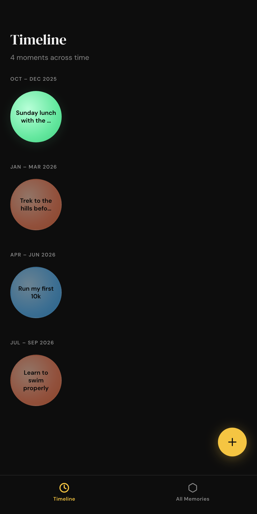
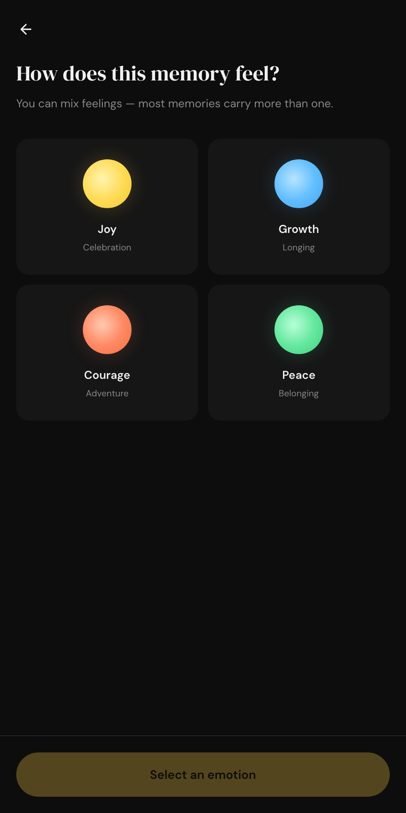
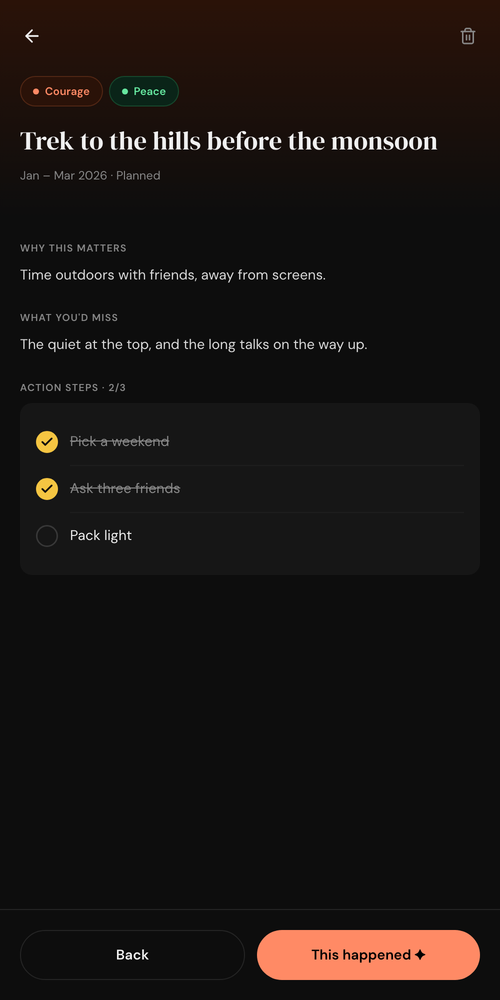

# Memory Moments

A calm, minimal app for logging the moments that matter: things that happened and things you're planning, organised by feeling and by quarter.

**Live demo: https://memorymoments.lovable.app**

<p>
  
  
  
</p>

More screens are in [`screenshots/`](screenshots/).

## Features

- **Timeline:** memories grouped by quarter, with the current quarter marked "Now".
- **Emotion picker:** tag a memory as Joy, Growth, Courage or Peace. You can pick more than one.
- **Add a memory:** title, quarter, why it matters, what you'd miss, and action steps.
- **Memory detail:** check off action steps, or delete the memory.
- **"This happened" reflection:** when a planned memory happens, re-pick how it felt and write a one-line reflection. It's then marked as past.
- **All memories:** a list view you can filter by emotion.
- **Onboarding** on first visit.
- **Installable (PWA):** add it to your phone's home screen and it opens full screen.

## Your data stays on your device

There's no account and no server. Memories are saved in the browser's `localStorage`:

- Nothing is uploaded or shared.
- Data doesn't sync between devices or browsers. Each visitor starts with an empty timeline.
- Clearing the browser's site data deletes all memories.

## Demo tips

- Open the link in a private or incognito window to see onboarding and start with an empty timeline.
- To reset, clear site data for `memorymoments.lovable.app` in your browser settings, or use a fresh private window.
- On a phone, use **Add to Home Screen** to show it as an app.
- After a new version is published, an installed or previously opened copy may show the old version once. Reload, and the new version loads.

## Run locally

Requires Node.js 18 or later.

```bash
npm install
```

```bash
npm run dev
```

The dev server runs at http://localhost:8080.

Other scripts:

| Command | What it does |
|---|---|
| `npm run build` | Production build into `dist/` |
| `npm run preview` | Serve the production build locally |
| `npm test` | Run tests (Vitest) |
| `npm run lint` | Run ESLint |

## Deploying

The app is built and hosted with [Lovable](https://lovable.dev). The project syncs both ways with this GitHub repo:

- Changes made in Lovable are committed to `main` here automatically.
- Changes pushed to `main` show up in Lovable, but **don't go live until you click Publish → Update in Lovable**.

It's a plain static Vite single-page app, so it can also be hosted elsewhere (Vercel, Netlify, Cloudflare Pages). Use `npm run build` with `dist/` as the output folder, and set up a fallback that serves `index.html` for every route, so links like `/timeline` work on refresh.

## Tech stack

Vite, React 18, TypeScript, Tailwind CSS, shadcn/ui (Radix), React Router, and vite-plugin-pwa.

## Project layout

```text
src/
  contexts/MemoryContext.tsx   state, reducer, and localStorage persistence
  lib/constants.ts             emotions, colours, quarter helpers, types
  pages/                       one file per screen
  components/                  shared UI (bubbles, cards, nav, emotion orbs)
  components/ui/               shadcn/ui primitives
screenshots/                   app screenshots used in this README
```
